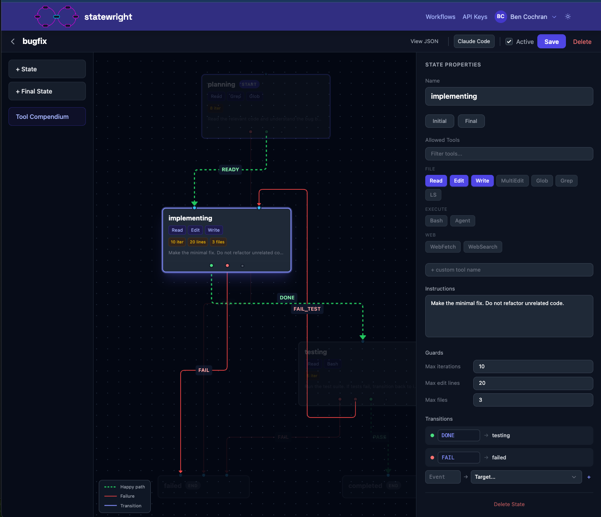

# statewright

> Agents are suggestions, states are laws.

Your workflows, in the harness you choose. Statewright defines tools, checks, and transitions for each phase of agent work. Use it with Claude Code, Codex, Cursor, OpenCode, Pi, or OMX, or connect a custom MCP host. Tool enforcement and model routing depend on the integration. [Full docs →](https://docs.statewright.ai)

> **0.3.4 release candidate:** Claude gains a native Arbiter, Desktop sidebar and compact results. Codex adds browser onboarding and managed Desktop continuity. [Claude notes](docs/releases/claude-0.3.4.md) · [Codex notes](docs/releases/codex-0.3.4.md). Not yet published.



## The problem

An agent with the same tools throughout a task can edit during review or deploy before checks finish. A workflow needs a way to make those boundaries explicit and, where the host supports it, enforce them before a tool runs.

## The approach

Define the tools and checks each phase needs. Planning can allow reading, implementation can enable edits, and testing can permit designated commands. On intercepted tool paths, the integration rejects calls outside the current phase and explains which tools and transitions are available. Managed shell checks also screen writes and destructive operations when edits are disallowed.

State machines support retries, loops, and approval gates. You can keep your selected model throughout a workflow or configure phase-specific routes on supported clients. The [research results](#research-results) below report a small local-model experiment, not a general model-size requirement.

## Quickstart

<details open>
<summary><strong>Claude Code</strong></summary>

```text
/plugin marketplace add statewright/statewright
/plugin install statewright@statewright
```
</details>

<details>
<summary><strong>Codex</strong></summary>

```sh
codex plugin marketplace add statewright/statewright
codex plugin add statewright@statewright
```
</details>

<details>
<summary><strong>OpenCode</strong></summary>

Use the [OpenCode setup guide](https://docs.statewright.ai/plugins/opencode)
to load the native plugin through the shared executor.
</details>

<details>
<summary><strong>Cursor</strong></summary>

Choose [Cursor Agent through the executor or standalone IDE mode](https://docs.statewright.ai/plugins/cursor).
The IDE's MCP/rules mode is advisory; the Agent integration adds native tool hooks.
</details>

Also available: [Pi](https://docs.statewright.ai/plugins/pi), [OMX](https://docs.statewright.ai/plugins/omx), and [custom MCP connections](https://docs.statewright.ai/getting-started/install#other-mcp-hosts). The [install guide](https://docs.statewright.ai/getting-started/install) covers every adapter and its connection requirements.

In Claude Code 2.1.295 or newer, run the plugin commands at Claude's prompt,
then open the Arbiter's connection status and choose **Connect**. Claude manages
its native OAuth login. In Codex, restart after installation and ask for
`statewright_connect`; approve the matching device code in your browser.
Neither flow requires pasting a key into the conversation. Other hosts have
their own connection instructions.

Existing Claude manual-hook installs must complete the
[migration](plugins/claude-code/README.md#upgrade-from-manual-hooks) before
starting a workflow; updating the plugin does not remove old settings hooks.

Desktop guides: [Claude Code → Local](https://docs.statewright.ai/plugins/claude-desktop)
uses the ordinary Claude app; [ChatGPT with Codex](https://docs.statewright.ai/plugins/codex-desktop)
uses the macOS **ChatGPT + Statewright** launcher. Ordinary cloud chats are a
separate integration and cannot enforce model routing.

Start with **agentic-engineering** (alias **engineering**) for a fix, small
feature, refactor or investigation. This illustrative sequence shows the normal
change path; actual states, events and tools come from the selected workflow:

```
❯ Use the engineering workflow to fix the failing tests in calc.py

◆ statewright — statewright_load_workflow (name: agentic-engineering)
◆ [statewright] Workflow activated: agentic-engineering

◆ statewright — statewright_get_state (MCP)

◆ diagnose → baseline: understand the failure and record a focused plan

  Read the relevant code; reproduce the failing test

◆ implement: make the smallest coherent change

  Edit calc.py and add regression coverage

◆ validate → review: check the result and look for missed cases

  Run the focused checks; record results and limitations

◆ handoff → complete: summarize the outcome and what was verified
◆ [statewright] Workflow complete.
```

In Claude, `/statewright` opens the sidebar: choose a workflow, then
**Start workflow**. Selection alone does not start a run.

The starter uses your selected model, supports evidence-backed no-change
outcomes, and allows one repair round before stopping with a useful handoff.
It does not automatically commit or deploy. See the
[starter workflow guide](docs/agentic-engineering.md) for boundaries and upgrades.

## Research results

In the reported experiment, two local models completed 2 of 10 attempts without Statewright constraints and 10 of 10 with them, using the same tasks and hardware. This covered a 5-task SWE-bench subset, not the full 2294-instance benchmark.

| Model | Size | Bug Fix (26 lines) | SWE-bench (5 tasks) |
|-------|------|--------------------|---------------------|
| gemma3 | 3.3GB | FAIL | FAIL |
| gemma4:e2b | 7.2GB | PASS* | FAIL |
| gpt-oss:20b | 13.8GB | PASS | PASS (5/5) |
| gemma4:31b | 19.9GB | PASS | PASS (5/5) |
| llama3.3 | 42.5GB | PASS | PASS (2/2)† |

*\*with specialized edit_line tool adaptation*
*†tested on 2 of the 5 tasks (added after initial experiment run)*

In this sample, the two models completing all five tasks were 13.8GB and 19.9GB; the smaller tested models did not complete that subset. These observations do not establish a minimum model size or isolate why a model failed. Outcomes depend on the tested tasks, model, tools, and configuration. [Research brief →](https://statewright.ai/research)

## How it works

### Architecture

Three layers, each independently useful:

1. **Engine** (`crates/engine`) — Pure Rust state machine evaluator. States, transitions, guards, tool restrictions. Deterministic. No LLM in the loop. No runtime dependencies.

2. **Agent binary** (`crates/cli`, binary: `sw-agent`) — Direct-to-Ollama agent executor. Loads a workflow, runs the LLM in a constrained loop, enforces tool access, and streams structured JSONL events. Supports per-state model routing via `--config`, and single-state execution via `--state` (the TUI or MCP gateway orchestrates, `sw-agent` executes one state at a time and exits).

3. **Executor and plugin layer** (`plugins/executor` + `crates/mcp-gateway` + `plugins/`) — One executor owns the workflow session, credentials, isolated delivery, telemetry, and host lifecycle. Thin host adapters translate native tool hooks and model-routing controls for Pi, Claude Code, OpenCode, Cursor, and OMX. Codex uses the same delivery core through its app-server adapter. The `statewright_run_agent` MCP tool remains available for states that benefit from direct Ollama execution.

The TUI (`crates/tui`, binary: `statewright`) is a ratatui terminal interface that spawns `sw-agent` as a subprocess and renders its JSONL event stream in real time. It handles keyboard input, demo mode, and fixture selection.

### Per-state model routing

States can specify a `model`; `meta.default_model` applies where no state
override is present. This is optional: the default engineering starter retains
your selected model. The native Claude 0.3.4 plugin routes subsequent
main-conversation requests without restarting the app. Codex's managed App
Server adapter routes turns. Pi and OpenCode switch live, Cursor's executor
resumes the same chat, and OMX applies its route at startup. Requested settings
are not execution receipts: use the response's observed model when available.

This configuration excerpt illustrates Haiku for diagnosis, Opus for a proposed fix, and Sonnet as the default. It omits transitions and other required workflow fields; use the [complete starter](workflows/agentic-engineering.json) or [authoring guide](https://docs.statewright.ai/workflows/create-your-own) for a runnable definition. It is not a measurement of token use or savings.

```json
{
  "meta": { "default_model": "claude-sonnet-4-20250514" },
  "states": {
    "diagnose": {
      "model": "claude-haiku-4-5-20251001",
      "allowed_tools": ["Read", "Bash"]
    },
    "propose_fix": {
      "model": "anthropic/claude-opus-4-6",
      "allowed_tools": ["Read"]
    },
    "execute": {
      "allowed_tools": ["Read", "Edit", "Bash"]
    }
  }
}
```

Here, `diagnose` requests Haiku, `propose_fix` requests Opus, and `execute` inherits the `default_model` (Sonnet). The `sw-agent` binary also accepts a `--config` file with a `model_routing` block for per-state Ollama URL, temperature, and context window overrides.

### Guardrails

| Guardrail | What it does |
|-----------|-------------|
| Per-state tool enforcement | Rejects tools outside `allowed_tools` on the integration's intercepted paths |
| Bash discernment | Blocks `echo > file`, `rm -rf`, `sed -i`, and scripting interpreters (`python`, `node`) when Write/Edit aren't allowed. Even if Bash itself is permitted. |
| Edit guards | Rejects diffs exceeding `max_edit_lines`, caps files edited per state |
| Command allow-lists | Only prefix-matched commands run (e.g. `pytest`, `cargo test`) |
| Conditional transitions | Programmatic guards on context data: `test_result eq pass`, `coverage gt 80` |
| Approval gates | `requires_approval` pauses for human review |

### Approval routing

Mark a transition with `requires_approval: true` to park it for review. The
gateway defaults to local UI routing and stores the pending approval (including
its `approval_message`) in the session state cache. Managed Codex and Claude
clients keep the workflow parked until the gate is resolved.

An approval transition may include a `statewright/evidence-packet/v1` manifest
with a concise summary, checklist, and project-relative artifacts. The managed
client hashes and uploads those files through the bound approval, then opens an
authenticated review page. Reviewers can inspect the packet from a browser or
mobile device without receiving the agent's turn history. Evidence retention is
plan-controlled, and path escape, unsupported files, or digest mismatch fail
closed.

Set `meta.approval_mode` to `"external"` when an out-of-band reviewer owns the
decision. In that mode clients leave the pending approval to that channel and
do not present a local prompt. Statewright does not currently ship a Telegram,
Slack, or Discord dispatcher; an external integration must resolve the pending
approval through the gateway callback/API.

Codex and Claude Code refresh their cached workflow state after a transition.
Codex presents an authorized native decision dialog and links the review page.
Claude's native sidebar exposes **Review this step** for a pending gate.
Native host permissions and Statewright review decisions remain separate.
An `external` approval mode leaves the decision to the configured integration.

Additional workflow controls:

| Guardrail | What it does |
|-----------|-------------|
| Interrupts | Edit a file matching a glob pattern? Auto-transition to a validation state, then return where you were |
| Fork/join | Run branches sequentially or in parallel, join when all (or any) complete |
| Environment scoping | Hide `PROD_DB_URL` via `blocked_env`, substitute with `env_overrides` |
| Session isolation | Per-session state via `CLAUDE_SESSION_ID` |
| Per-state model routing | Request a model per state on supported clients, using `model` per state and `default_model` in `meta`. |
| Thinking level control | Per-state `thinking_level` field (`high`, `medium`, `low`, `off`) for clients that support reasoning effort tuning. |
| Tool escalation detection | Validator warns when a state jumps 2+ privilege levels without an approval gate |

Full guardrail reference in [the docs](https://docs.statewright.ai/tools/reference).

## Define your own workflows

```json
{
  "id": "bugfix",
  "initial": "planning",
  "meta": {
    "default_model": "claude-sonnet-4-20250514"
  },
  "states": {
    "planning": {
      "allowed_tools": ["Read", "Grep", "Glob"],
      "model": "claude-haiku-4-5-20251001",
      "thinking_level": "low",
      "max_iterations": 8,
      "on": { "READY": "implementing" }
    },
    "implementing": {
      "allowed_tools": ["Read", "Edit", "Write"],
      "max_edit_lines": 20,
      "max_files_per_state": 3,
      "on": { "DONE": "testing" }
    },
    "testing": {
      "allowed_tools": ["Read", "Bash"],
      "allowed_commands": ["pytest", "cargo test", "npm test"],
      "on": {
        "PASS": { "target": "completed", "guard": "tests_passed" },
        "FAIL_TEST": "implementing"
      }
    },
    "completed": { "type": "final" }
  },
  "guards": {
    "tests_passed": { "field": "test_result", "op": "eq", "value": "pass" }
  }
}
```

Point your agent at the [JSON schema](https://statewright.ai/workflow-schema.json) and it generates a workflow via `statewright_create_workflow`. Tweak tools, commands, and environment blocks in the [visual editor](https://statewright.ai/workflows).

## Supported agents

Enforcement and model routing depend on the host. Claude 0.3.4 is a native
plugin; it needs no shim. Codex uses a managed App Server adapter. Neither
changes a model midway through a response. The separate
[`statewright-exec`](plugins/executor/) transport supports executor-owned
delivery and other hosts; it is not Claude's consumer Desktop integration.

| Agent | Release line | Executor integration | Tool enforcement | Route boundary |
|-------|--------------|----------------------|------------------|----------------|
| [Claude Code / Desktop Code](plugins/claude-code/) | 0.3.4 candidate | Native mod + OAuth | Native pre-permission check* | Main-conversation request |
| [Codex](plugins/codex/) | 0.3.4 candidate | App-server hooks + shared executor bridge | Intercepted native paths | App Server turn |
| [Oh My Codex](plugins/omx/) | 0.1.x | Native hooks + executor MCP bridge | Hard | Startup |
| [Pi](plugins/pi/) | 0.3.0 | Native extension + executor MCP bridge | Hard* | Live |
| [OpenCode](plugins/opencode/) | 0.3.0 | Native plugin + executor MCP bridge | Hard | Live |
| [Cursor](plugins/cursor/) | 0.2.0 | Native hooks + executor MCP bridge | Hard in executor mode | Resume same chat |

*Claude checks the call before permission settlement. A later host-side argument
rewrite may execute without another pre-check; post-call comparison detects
that case but does not prevent it. Pi includes tool-name normalization and
tool-call recovery for local models (Ollama, LM Studio).*

Custom MCP hosts can use the gateway's workflow tools. A remote connection alone does not intercept every native tool or change the host's model. Check the integration guide for the controls available in your setup; native permissions remain in effect.

### Isolated delivery

The shared executor can create clean multi-repository worktrees before a task
starts, then run project-owned Taskfile hooks for preview preparation,
deployment, validation, promotion, and cleanup. Codex and the other executor
hosts use the same pinned delivery core. Statewright limits the hook environment
and binds deploy and validation evidence to the exact source fingerprint. See the
[isolated delivery guide](plugins/codex/docs/isolated-delivery.md).

### MCP tools

The gateway exposes these tools to the connected agent:

| Tool | Purpose |
|------|---------|
| `statewright_load_workflow` | Activate a named workflow, optionally resuming a paused run |
| `statewright_get_state` | Current state, allowed tools, transitions, iteration count, model, thinking level |
| `statewright_transition` | Emit an event to advance the state machine |
| `statewright_list_workflows` | List available workflows and which is active |
| `statewright_create_workflow` | Create a new workflow from a JSON definition |
| `statewright_pause` | Pause the current run; resume later with `load_workflow(resume=true)` |
| `statewright_deactivate` | Turn off enforcement; all tools pass through |
| `statewright_get_status` | Gateway health: active workflow, state, available workflows |
| `statewright_run_agent` | Spawn the Rust agent executor (`sw-agent`) for direct-to-Ollama bug fixing |
| `statewright_force_state` | Jump to any state bypassing guards (debug mode only, gated on `meta.debug`) |

## Pricing

The managed cloud at [statewright.ai](https://statewright.ai) handles workflow storage, run history, and the MCP gateway. The Pro Early Bird price stays locked at $9/mo while the subscription remains active.

| Plan | Workflows | Transitions/mo | Run History | Price |
|------|-----------|-------------|----------------|-------|
| Free | 3 | 200 | 72 hours | $0 |
| Pro | 10 | 2500 | 7 days | ~~$19~~ $9/mo (Early Bird) |
| Team | 30 | 10000 | 90 days | $99/mo |
| Enterprise | Unlimited | Unlimited | to Specification | [Contact us](mailto:sales@statewright.ai) |

## Self-hosting

Run the full stack locally with Docker Compose — PocketBase, MCP gateway, and workflow editor. BYO Ollama. [Self-hosted guide →](https://docs.statewright.ai/getting-started/self-hosted)

```bash
cd self-hosted && docker compose up --build
```

The engine (`crates/engine`) and agent layer (`crates/agent`) are Apache 2.0, embeddable with no runtime dependencies. The MCP gateway is FSL-1.1-ALv2 (converts to Apache 2.0 in 2029). Single-developer and single-team self-hosting is permitted under the FSL license.

## Tradeoffs

- Requires MCP support in the agent (or hooks for non-MCP agents like Codex)
- Workflow definitions are authored by hand, though agents can generate them via `statewright_create_workflow`
- Standalone Cursor MCP/rules mode remains advisory. `statewright-exec --host cursor` uses Cursor hooks for hard enforcement and resumes the same chat across route changes.
- Research results are from a 5-task SWE-bench subset, not the full 2294-instance benchmark
- If a workflow is too restrictive, the agent gets stuck. `statewright_deactivate` is the escape hatch

## Docs

[docs.statewright.ai](https://docs.statewright.ai) — install guide, workflow authoring, [schema reference](https://docs.statewright.ai/workflows/schema-reference), [MCP tool reference](https://docs.statewright.ai/tools/reference), [agent-generated workflows](https://docs.statewright.ai/tools/agent-generated-workflows), and [isolated delivery](https://docs.statewright.ai/features/isolated-delivery/).

## Contributing

Workflow definitions, templates, and bug reports welcome. See [Create Your Own](https://docs.statewright.ai/workflows/create-your-own/) for how to write workflows.

- [Report an issue](https://github.com/statewright/statewright/issues/new)
- [Discussions & feedback](https://github.com/statewright/statewright/discussions)

## License

Apache 2.0 — portions [FSL-1.1-ALv2](https://fsl.software) (converts to Apache 2.0 on May 3, 2029). Managed cloud at [statewright.ai](https://statewright.ai).

This project includes a [patent pledge](./PATENTS.md) covering independent implementations of the techniques described in the patent. Solo developers, researchers, open source projects, and single-team self-hosted deployments are covered regardless of whether they use Statewright software.

> One hook to rule them all.


